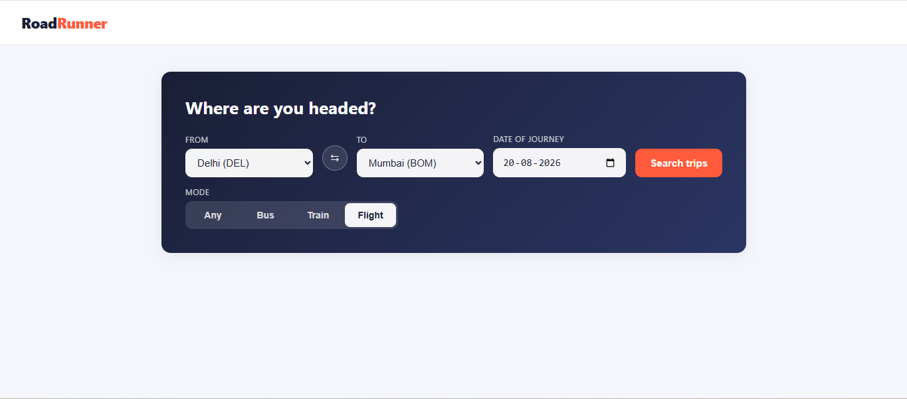
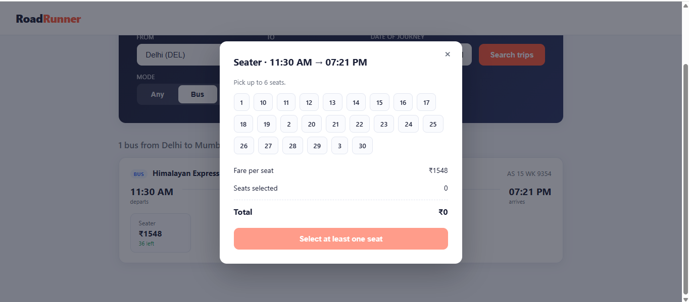
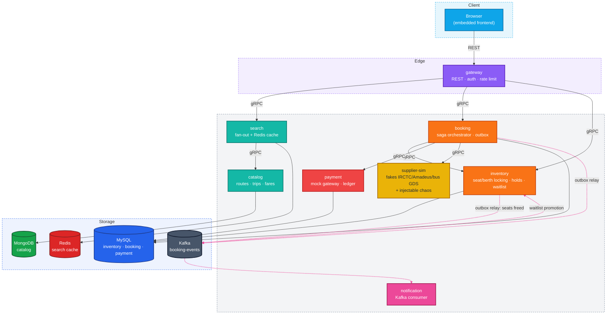
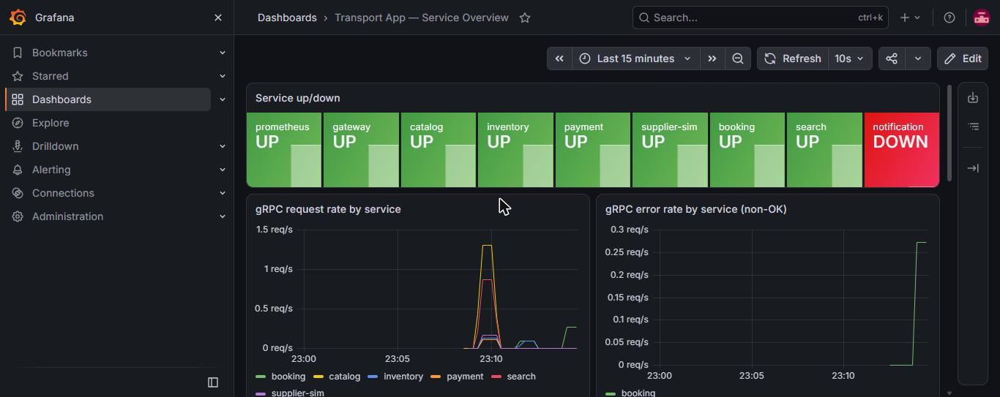
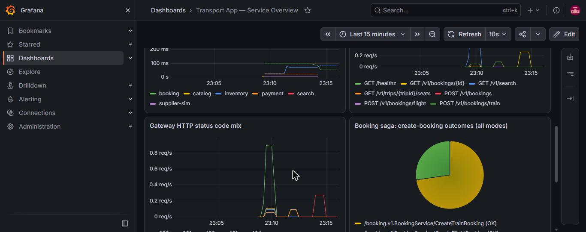

# RoadRunner Transport

[](https://github.com/Muditjain13/RoadRunnerProject/actions/workflows/ci.yml)


[](LICENSE)

A multi-modal (bus, train, flight) travel booking backend in Go, built as
a portfolio piece demonstrating distributed-systems engineering:
correctness under concurrency and failure, not feature breadth. Eight
services behind one booking engine, three supplier adapters, and a saga
that survives a crash at any step.

This is **not a product**. Every design decision optimizes for two
things: (1) proving five specific correctness claims under real
contention and real failure, and (2) being readable by a senior engineer
in about 15 minutes. If you're skimming, read the five claims below, then
[the booking saga](docs/architecture.md#the-booking-saga), then whichever
`docs/adr/` or `docs/perf/` page matches what you're curious about.

## What it looks like

A real, running app - search across bus/train/flight, pick a mode, pick
seats:




## The five claims this repo has to prove

| # | Claim | Where it's proven |
|---|---|---|
| 1 | No double-booking under contention | `TestCreateHold_ConcurrentSameSeat` (100 goroutines, 1 seat), `TestPromoteWaitlistHead_NeverDoublePromotes` (50 goroutines racing a 2-of-2-entries promotion) |
| 2 | A multi-step distributed transaction converges under partial failure | [The hard case](#the-hard-case) - payment succeeds, supplier declines, automatic refund. Proven with fakes (`TestCreateBooking_SupplierDeclines_HardCase`, `TestCreateFlightBooking_SupplierDeclinesConfirm_HardCase`) **and** live, with real refund rows in the payment ledger (see below) |
| 3 | At-least-once delivery processed exactly-once in effect | Every Kafka consumer step is idempotent by key (`internal/notification`, inventory's waitlist promotion) - see `docs/adr/0002-resumable-saga.md` |
| 4 | Graceful degradation when a provider is slow or down | `errgroup`-based fan-out in `search` never lets one slow provider block the others (`TestSearch_OneProviderFailingDoesNotAffectOthers`); circuit breaker on every flight supplier call (`pkg/circuitbreaker`, `make chaos`) |
| 5 | Relational query performance is measured, not assumed | `docs/perf/` - real EXPLAIN plans and timings at ~5.7M seats and ~20M events, not estimates |

## Architecture

The full system diagram and the booking saga sequence diagram live in
[`docs/architecture.md`](docs/architecture.md). Solid arrows are
synchronous (REST or gRPC), dotted arrows are asynchronous (Kafka).



**Why two databases**, in one sentence each: MySQL holds seats, holds,
bookings, and the payment ledger - money and inventory need ACID
transactions and row locking, not a document store. MongoDB holds the
catalog - a bus, a train, and a flight share almost no schema (grid vs.
coach/berth vs. cabin/fare-class), so forcing that into MySQL means 40
nullable columns or a JSON blob; Mongo is the honest choice.

### The three concurrency models

| Mode | Inventory owner | Locking strategy |
|---|---|---|
| Bus | We own it | Pessimistic `SELECT ... FOR UPDATE` on the seat row, local transaction |
| Train | We own it, with quotas | Row lock plus waitlist queue when the quota is exhausted |
| Flight | Provider owns it | No local lock possible. External hold, PNR reconciliation, compensating cancel |

All three run through the **same saga** (`internal/booking/service`).
`advance()`, `doHold`, `doCharge`, `doConfirm`, `doCompensate` do not
branch on mode anywhere - train and flight each added at most two thin
entry-point methods and a couple of interface type-assertions, never a
change to the core state machine. That was a deliberate, checked
constraint the whole way through, guided by one rule kept in the
project's own design notes: *"If you are about to write
`if mode == "flight"` inside the booking, inventory, or saga code, stop.
The abstraction has leaked."*

## The hard case

The single most important failure mode this repo exists to handle:
**payment succeeds, but the supplier declines to confirm.** Money has
already moved, so the seat can't just be released - it requires an
automatic refund plus a reconciliation sweeper for anything that gets
stuck mid-saga.

Verified live, not just in tests: with `supplier-sim` forced to decline
100% of flight confirmations (`--flight-error-rate=1.0`), a real booking
request was charged, declined, and automatically compensated:

```
POST /v1/bookings/flight -> 201
{ "status": "STATUS_CANCELLED",
  "failure_reason": "supplier declined confirmation: ... supplier declined the booking" }
```

...with matching rows in the payment ledger:

| payments | | | refunds | |
|---|---|---|---|---|
| amount_paise | status | | amount_paise | status |
| 515601 | succeeded | | 515601 | succeeded |

## Performance

Full write-ups with real `EXPLAIN` plans and timings in
[`docs/perf/`](docs/perf/):

- **[Covering index](docs/perf/seat-availability-index.md)** on the
  seat-availability query: `Handler_read_next` 1224 → 648 (zero wasted
  row scans) at 5.7M seeded seats.
- **[Monthly partitioning](docs/perf/booking-events-partitioning.md)** of
  a 20M-row historical events table: a date-range query went from 9.75s
  (full scan) to 2.75s (pruned to one partition) - **3.5x**.
- **[Deferred-index bulk load](docs/perf/bulk-load-deferred-indexes.md)**:
  measured honestly, including the case where the effect was *smaller*
  than the general rule of thumb suggests, and why.

## Observability

Every service exports Prometheus RED metrics (`grpc_server_requests_total`
/ `_duration_seconds`, or `gateway_http_requests_total` for the REST
edge) and a gRPC health check (`pkg/middleware.RegisterHealth`) that
Kubernetes' native `grpc` probe type checks directly.

Real dashboard, built against a live Prometheus scraping all 7 running
services, with real traffic (including the error panel - those are real
404/NotFound responses, not synthetic data):




Dashboard JSON is checked in at
[`deploy/grafana/transport-app-overview.json`](deploy/grafana/transport-app-overview.json).
`notification` shows DOWN in the "service up/down" panel because it
genuinely isn't running in this environment (no Kafka broker up) - shown
as-is rather than staged to look complete.

## Tech stack

| Concern | Choice |
|---|---|
| HTTP router | stdlib `net/http` (Go 1.22+ routing) |
| RPC | gRPC + protobuf, `buf` for codegen |
| MySQL access | `sqlc` - no ORM |
| Mongo | official `mongo-go-driver` |
| Kafka | `segmentio/kafka-go` |
| Migrations | `golang-migrate` |
| Metrics / tracing | Prometheus + OpenTelemetry → Jaeger |
| Testing | `testing`, `testify`, `testcontainers-go` (see [environment note](#environment-note)) |

Each choice is a deliberate tradeoff - standard library over a framework
wherever it covers the need, no ORM, real protobuf contracts between
services.

## Layout

```
/cmd/<service>/main.go       entrypoint per service
/internal/<service>/         service-private code (handler / service / repo)
/pkg/                        genuinely shared: errors, middleware, otel, kafka wrapper
/api/proto/                  .proto files, generated stubs committed
/migrations/<service>/       golang-migrate SQL files
/deploy/compose/             docker-compose.yml (the reference way to run this)
/deploy/k8s/                 Kubernetes manifests - see its own README for caveats
/deploy/grafana/             checked-in dashboard JSON
/deploy/local/               native (non-Docker) Prometheus config, used to build the screenshots above
/docs/adr/                   architecture decision records
/docs/perf/                  EXPLAIN output and before/after benchmarks
/docs/screenshots/           the Grafana screenshots above
```

## Running it

```bash
make up            # docker compose up, all services + infra, seeded
make seed          # ~5.7M seats, ~20M booking events, 10 cities, deterministic
make test          # go test -race ./...
make chaos         # supplier-sim with 40% flight error rate + 2s p99 latency
```

`make up` is the reference path and hasn't been re-verified against a
fresh Docker host from this exact commit - see the
[environment note](#environment-note). Everything described in this
README (the hard case, the perf numbers, the dashboard) was verified
running the same binaries as native Windows processes against native
MySQL/MongoDB, not through docker-compose, because no Docker was
available in the sandbox this was built in. The compose file and
Dockerfile are real and match every service's actual env vars (see
`deploy/k8s/`'s manifests, generated from the same source of truth), but
"docker compose up and it just works" is the one thing in this README
that's inference from the code rather than something actually observed.

### Environment note

Every push runs two [CI](.github/workflows/ci.yml) jobs on GitHub Actions:
build, `go vet` and `go test -race` with coverage, and the full
`testcontainers-go` integration suite against real MySQL containers. The
project was originally built in a sandbox with no Docker and no C
compiler, so the functional claims, the perf numbers and the dashboard
below were first verified against native MySQL/MongoDB processes. The
first CI run of the integration suite then caught two real concurrency
bugs in `payment` (see
[Bugs caught by concurrency testing](#bugs-caught-by-concurrency-testing)).

## Build history

Built in this order, each phase verified live before moving to the next
(not strictly the originally planned 1→2→3→4→5 order - phases 3 and 4
were built before phase 2):

1. **Bus, end to end.** Search → hold → pay → confirm → cancel, full
   tests, metrics, traces.
2. **Performance.** Seeded at volume, added the covering index and
   partitioning above, recorded real before/after numbers.
3. **Train.** Coach/berth model, quotas, FIFO waitlist with promotion -
   the booking saga needed two new thin entry points and nothing else.
4. **Flight.** External hold via a new supplier-sim RPC pair, circuit
   breaker, the hard case proven live with forced chaos.
5. **Polish.** This README, the Kubernetes manifests, the architecture
   diagram, the Grafana dashboard.

## ADRs

- [`0001-hold-expiry-sweeper.md`](docs/adr/0001-hold-expiry-sweeper.md) - polling sweeper over Kafka delayed messages
- [`0002-resumable-saga.md`](docs/adr/0002-resumable-saga.md) - idempotent-by-key steps over an event-sourced saga log

## Known gaps

Said plainly rather than left for someone to discover:

- No CI pipeline builds or publishes the `transport-app/<service>:latest`
  images the Kubernetes manifests reference.
- `notification` and the Kafka broker are not running in the environment
  these docs were verified against - the outbox/relay code path is
  written and unit-tested, but the consumer side wasn't exercised live in
  this session (matches its own tolerant design: a missing broker never
  crashes the producer side, per every service's Kafka wrapper).
- `make up` (docker compose) is not yet covered by CI.
