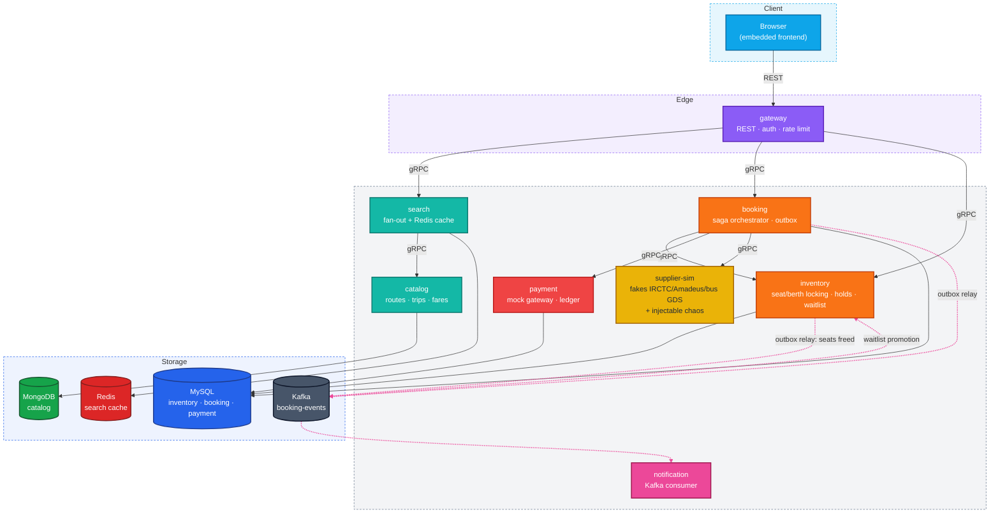
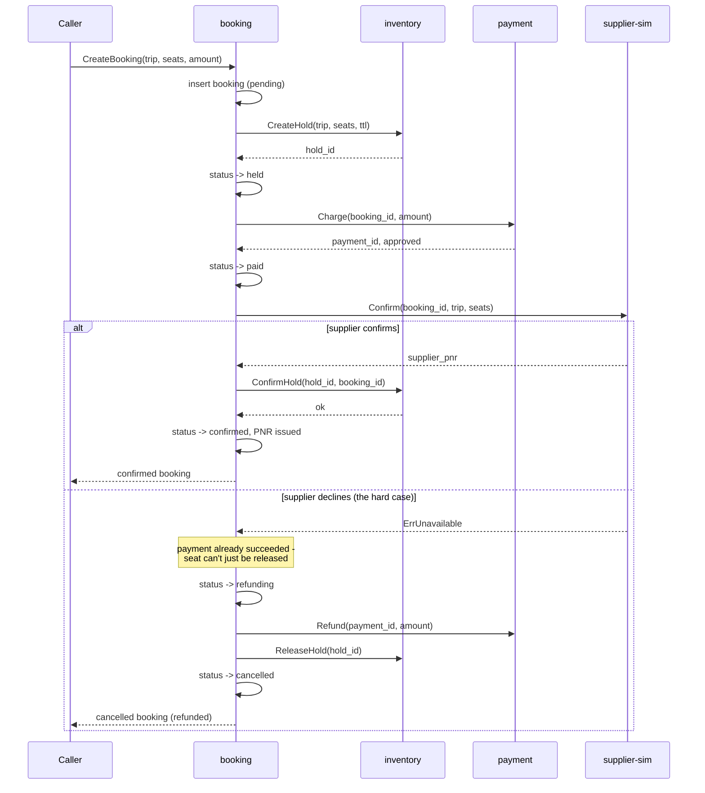

# Architecture

## System overview

Dotted arrows are asynchronous (Kafka); solid arrows are synchronous
(REST or gRPC). The only two dual-purpose paths are `inventory`'s outbox
(seat-freed events durably retry a promotion that already ran
synchronously - see `internal/inventory/service/service.go`'s
`tryPromoteAfterFree`) and `booking`'s outbox (confirmed/cancelled events
feed `notification`).

## The booking saga

Every step past the initial hold (`Charge`, supplier `Confirm`,
`ConfirmHold`, `Refund`, `ReleaseHold`, supplier `Cancel`) is idempotent
on a key derived from the booking ID. That is what makes this diagram
also describe crash recovery: the reconciliation sweeper
(`RunReconciliationSweeper`) finds any booking whose `updated_at` is
stale for its status and just re-runs the same `advance()` state machine
the synchronous path above uses - no separate "what happened while I was
down" logic. See `docs/adr/0002-resumable-saga.md`.

Train and flight follow the identical diagram from the `held` step
onward - they differ only in *how* the hold is acquired (train:
`CreateHoldByClass`, inventory picks seats or waitlists; flight:
`Hold`/`ReleaseHold` on the supplier adapter, no local inventory at all).
`advance()`, `doCharge`, `doConfirm`, and `doCompensate` do not know or
care which mode they're running.

## The three concurrency models

| Mode | Inventory owner | Locking strategy |
|---|---|---|
| Bus | We own it | Pessimistic `SELECT ... FOR UPDATE` on the seat row, local transaction |
| Train | We own it, with quotas | Row lock plus waitlist queue when the quota is exhausted |
| Flight | Provider owns it | No local lock possible. External hold (`Hold`/`ReleaseHold`), PNR reconciliation, compensating cancel |
